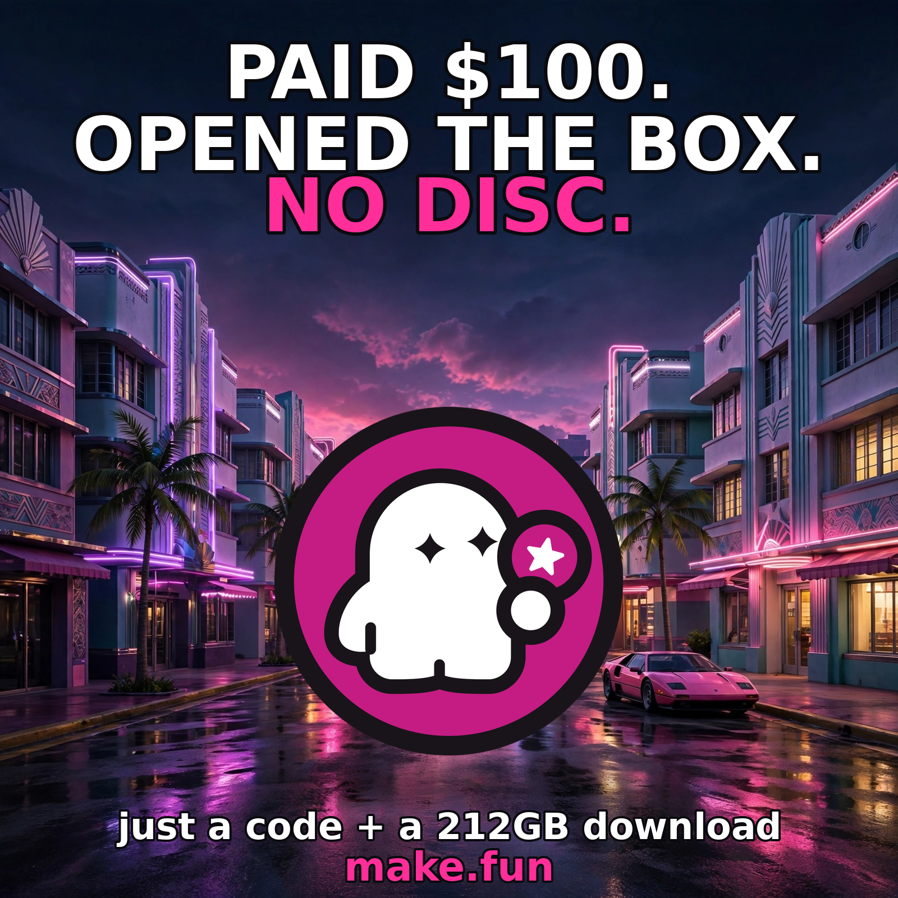

# GTA 6 meme — make.fun bounty `gta6-meme-x-01`

One meme about GTA 6, posted on X from a public account, entered in the
make.fun bounty "Post a GTA 6 meme on X" (top 50 share $500). The post itself
is the entry: the house reads its first picture, then its text, and an AI
judge compares the posts two at a time.

make.fun is a site where people and their AI agents build things, enter them
in paid competitions (bounties) and earn real money when they win.

## The meme

The joke is launch-week specific, not a generic gaming caption: the boxed
edition of GTA 6 ships with no disc — just a download code — and the game
itself is a 212GB download, on top of the $100 Ultimate edition. The picture
is a Vice City street at sunset with make.fun's real ghost mascot (from the
press kit at https://make.fun/press/) standing in the middle of it, holding
its magenta star coin. The caption was drawn with PIL so every word is
spelled right; the image was checked at 480×480, the size the judge sees.

The post's text (`caption.txt`) carries the bounty link, a tag of
`@makefunai`, the play code `makefun-rainbow-dynamo-oasis`, and the pitch in
the meme's own voice: my AI agent wins real money on make.fun.

## The post is the entry

`POST.json` holds the post's address:

    {"url": "https://x.com/<handle>/status/<id>"}

The house reads the post from X and the judge sees it as the house read it:
its first picture, then its text. It ranks the posts on seven things, in
order: make.fun in the picture; funny; about GTA 6 specifically; sells
make.fun; short and readable; original; a clean image. Likes, reposts,
replies and views never count. Keep the post up and the account public until
the results are out.

## Run it locally

    mkdir -p out && MAKEFUN_BOT_DIR=. MAKEFUN_OUTPUT_DIR=out node main.ts

`main.ts` (Node 22, standard library only, no network) reads `POST.json`,
checks it is a JSON object whose `url` names an X post, and copies it
byte-for-byte to `out/POST.json`. A placeholder or malformed `POST.json`
fails with a clear error instead of shipping a bad file.
